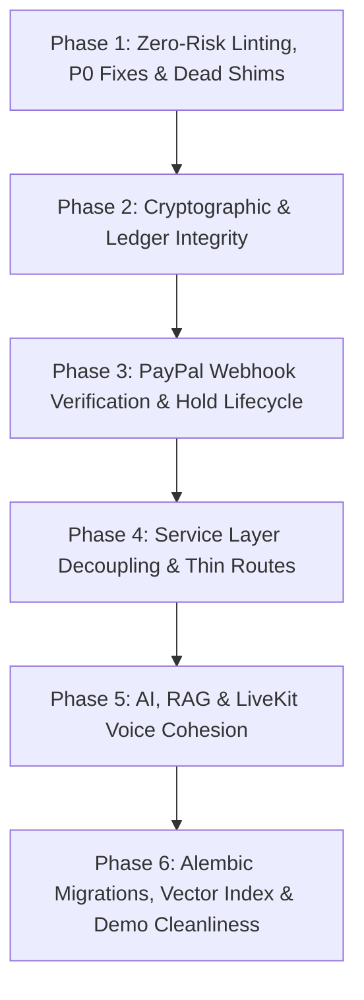

# SalonDesk Backend Architectural Gap Report & Refactoring Blueprint

**Auditor:** Principal Backend Architect & Systems Auditor  
**Scope:** `@backend/` (FastAPI / SQLAlchemy 2.0 Async / LiveKit Voice / PayPal Integration)  
**Target Architecture Benchmark:** Pragmatic Hybrid Layered Architecture  
**Date:** October 21, 2026  
**Status:** READ-ONLY AUDIT COMPLETE — AWAITING SYSTEMATIC EXECUTION

---

## 1. Executive Health Scorecard

| Dimension | Rating | Executive Justification |
| :--- | :---: | :--- |
| **1. Module Duplication & Dead/Split Code** | 🔴 Critical Gap | Numerous re-export shims (`app/services/{llm,rag_service,embeddings,ai_parser,voice_tools,audit_service}.py`, `app/models/{consent,change_request}.py`, and `app/scripts/`) create split imports and fragmentation across tests, scripts, and runtime modules. |
| **2. Layer Boundary Violations & Paradigm Inconsistencies** | 🔴 Critical Gap | Heavy transport-layer coupling: 10+ route files execute direct SQLAlchemy queries and transactions (`catalog.py`, `employees.py`, `analytics.py`), response standard is handled via expensive body-buffering middleware rather than compile-time types, and services mix class-based and procedural patterns with circular dependencies. |
| **3. Deterministic Policy Engine & Cryptographic Integrity** | 🔴 Critical Gap | Policy engine lacks booking state machine transitions and RBAC rules; `app/core/crypto.py` generates ephemeral in-memory Ed25519 keys if the env var is missing (breaking signature verification); server signs its own consent text; and the ledger hash chain lacks concurrency serialization and webhook coverage. |
| **4. PayPal Integration Depth & Resiliency** | 🔴 Critical Gap | Webhook signatures are completely unverified (`verification_status="UNVERIFIED"` in `webhooks/paypal.py`); `hold_expiration.py` has an undefined `asyncio` runtime crash; dispute and post-capture refund webhooks are unhandled; and authorization expiration beyond Day 4 is incomplete. |
| **5. Async SQLAlchemy 2.0, Migrations & Blocking I/O Risks** | 🟡 Needs Refactor | Alembic directory contains zero migrations (`alembic/versions/` only has `.gitkeep`), relying on brittle ad-hoc SQL sync in seed helpers; partial-commit / outbox risk on PayPal captures; and storage service encapsulates synchronous `boto3` calls. |
| **6. AI, RAG & LiveKit Voice Agent Cohesion** | 🟡 Needs Refactor | The LiveKit voice agent worker bypasses `app/ai/llm/` and builds separate DB engines and LLM clients; `assistant.py` duplicates chat prompting; structured Pydantic validation and prompt-injection defenses are missing from `BaseLLMService`; and LLM fallback chains are never invoked by HTTP routes. |
| **7. Test Coverage, Linting & Docker/Demo Readiness** | 🟡 Needs Refactor | Ruff reports 7 errors (including a syntax `NameError: asyncio` in background tasks and 6 unused imports); `scripts.ingest_knowledge` is never run in `entrypoint.sh` or `POST /demo/reset`, leaving demo containers with 0 RAG knowledge chunks. |

---

## 2. Duplicate & Dead Code Inventory

The table below outlines all redundant, shim, or split modules that must be unified into canonical locations:

| Current Source Location | Target Canonical Location | Current Importers & Callers | Recommended Action |
| :--- | :--- | :--- | :--- |
| `app/services/llm/__init__.py`<br>`app/services/llm/base.py` | `app/ai/llm/` | `tests/services/test_llm_config.py:12, 125, 153` | Update test imports to `app.ai.llm` and delete `app/services/llm/`. |
| `app/services/rag_service.py` | `app/ai/rag_service.py` | `tests/services/test_rag_service.py:5` | Update test imports to `app.ai.rag_service` and delete shim. |
| `app/services/embeddings.py` | `app/ai/embeddings.py` | `scripts/ingest_knowledge.py:35` | Update script imports to `app.ai.embeddings` and delete shim. |
| `app/services/ai_parser.py` | `app/ai/parser.py` | `tests/services/test_llm_config.py:11` | Update test imports to `app.ai.parser` and delete shim. |
| `app/services/voice_tools.py` | `app/ai/tools/catalog_tools.py` | None (dead shim) | Delete `app/services/voice_tools.py`. |
| `app/services/audit_service.py` | `app/services/ledger_service.py` | None (dead shim) | Delete `app/services/audit_service.py`. |
| `app/models/consent.py` | `app/models/policy.py:Consent` | `app/services/payment_service.py:17` | Update `payment_service.py` to import `Consent` from `app.models.policy` and delete shim. |
| `app/models/change_request.py` | `app/models/policy.py:ChangeRequest` | `app/services/change_request_service.py:12` | Update `change_request_service.py` to import from `app.models.policy` and delete shim. |
| `app/scripts/seed.py`<br>`app/scripts/ingest_knowledge.py`<br>`app/scripts/t6_sandbox_runner.py` | `scripts/` (root-level scripts) | `scripts/ingest_knowledge.py` docs | Update documentation/tooling to use `python -m scripts.<module>` and delete `app/scripts/`. |
| `app/api/v1/client/assistant.py` | `app/api/v1/client/chat.py` | Route definitions (`/ai/booking-assistant`, `/ai/owner-copilot`) | Merge specialized prompts into `chat.py` or consolidate into a single clean assistant router. |
| `app/services/paypal_toolkit.py` vs `app/ai/tools/paypal_tools.py` | Unified in `app/services/paypal_toolkit.py` | `app/api/v1/client/chat.py:66`, `tests/integrations/test_t9_agent_paypal.py` | Keep `paypal_toolkit.py` as pure service runner; keep `paypal_tools.py` as pure LiveKit tool registration. Clean up duplicate amount parsing & dead constants. |

---

## 3. File-by-File Architectural Gaps

### Priority P0: Critical / Financial, Cryptographic & Security

#### Gap P0-1: Undefined `asyncio` Runtime Crash in Background Hold Expiration
- **File & Line:** [app/tasks/hold_expiration.py:L23](file:///Users/mac/Desktop/Paypal/Salon-Desk/backend/app/tasks/hold_expiration.py#L23)
- **Violation:** `await asyncio.sleep(interval_seconds)` is invoked inside `run_hold_expiration_loop`, but `import asyncio` is completely omitted from module imports.
- **Impact:** When the application starts up and `lifespan()` in `app/main.py:30` launches `run_hold_expiration_loop`, the task crashes with `NameError: name 'asyncio' is not defined`, silently terminating the hold expiration supervisor.
- **Concrete Fix:** Add `import asyncio` at the top of [app/tasks/hold_expiration.py](file:///Users/mac/Desktop/Paypal/Salon-Desk/backend/app/tasks/hold_expiration.py).

#### Gap P0-2: Unverified PayPal Webhook Signatures (Public Webhook Spoofing)
- **File & Line:** [app/api/v1/webhooks/paypal.py:L19-L25](file:///Users/mac/Desktop/Paypal/Salon-Desk/backend/app/api/v1/webhooks/paypal.py#L19-L25)
- **Violation:** The webhook endpoint parses incoming JSON and passes `verification_status="UNVERIFIED"` directly into `ingest_webhook()`. There is zero cryptographic verification of `PAYPAL-AUTH-ALGO`, `PAYPAL-CERT-URL`, `PAYPAL-TRANSMISSION-ID`, `PAYPAL-TRANSMISSION-SIG`, or `PAYPAL-TRANSMISSION-TIME`.
- **Impact:** Any unauthenticated third party can POST fabricated `PAYMENT.CAPTURE.COMPLETED` or `PAYMENT.AUTHORIZATION.VOIDED` JSON payloads to `/api/v1/webhooks/paypal`, causing holds to be marked captured or voided without actual payment.
- **Concrete Fix:**
  1. Add `verify_webhook_signature(...)` to `PayPalRestClient` invoking PayPal REST `/v1/notifications/verify-webhook-signature`.
  2. In `app/api/v1/webhooks/paypal.py`, extract PayPal transmission headers and verify against the webhook ID before passing the payload to `ingest_webhook()`. Reject invalid signatures with HTTP 401/400.

#### Gap P0-3: Ephemeral Key Generation in Ed25519 Crypto Engine
- **File & Line:** [app/core/crypto.py:L24-L30](file:///Users/mac/Desktop/Paypal/Salon-Desk/backend/app/core/crypto.py#L24-L30)
- **Violation:**
  ```python
  def _load_or_create_private_key() -> Ed25519PrivateKey:
      settings = get_settings()
      if settings.ed25519_private_key:
          raw = b64decode(settings.ed25519_private_key)
          return Ed25519PrivateKey.from_private_bytes(raw)
      return Ed25519PrivateKey.generate()
  ```
- **Impact:** When `ED25519_PRIVATE_KEY` is omitted from the environment, every call to `sign_message()` generates a brand-new in-memory ephemeral key. Subsequent calls to `verify_signature()` generate another ephemeral key, guaranteeing verification failure. Consent signatures stored in the database cannot be verified.
- **Concrete Fix:** Enforce a persistent application key. If running in production or staging, require `settings.ed25519_private_key` at startup (`raise RuntimeError(...)`). For local development, cache a single lazily-generated key in memory (`lru_cache` or module singleton) and log a prominent security warning.

#### Gap P0-4: Server-Side Self-Signing of Client Consent
- **File & Line:** [app/services/payment_service.py:L74-L82](file:///Users/mac/Desktop/Paypal/Salon-Desk/backend/app/services/payment_service.py#L74-L82)
- **Violation:** `terms_hash, signature = build_consent_signature(terms_text)` invokes the server's own Ed25519 private key to sign the terms text, rather than receiving and verifying a client-attested cryptographic signature or client auth session assertion.
- **Impact:** The stored consent signature proves only that the backend server generated a signature, not that the end-user cryptographically signed or attested to the terms.
- **Concrete Fix:** Clarify the cryptographic trust model. If client signing is client-side, accept `client_signature_b64` and verify with client's public key or verified JWT assertion. If server-side attestation, document and record `terms_hash`, client UUID, IP, user-agent, and server timestamp signed by the platform authority.

#### Gap P0-5: Concurrency Forking & Missing Coverage in Ledger Hash Chaining
- **File & Line:** [app/services/payment_service.py:L26-L60](file:///Users/mac/Desktop/Paypal/Salon-Desk/backend/app/services/payment_service.py#L26-L60) & [L560-L566](file:///Users/mac/Desktop/Paypal/Salon-Desk/backend/app/services/payment_service.py#L560-L566)
- **Violation:**
  1. `_latest_ledger_hash` runs `select(LedgerEntry).order_by(LedgerEntry.created_at.desc()).limit(1)` without table or row locking. Concurrent requests can read the same `previous_hash` and fork the hash chain.
  2. In `ingest_webhook()` ([L561-L565](file:///Users/mac/Desktop/Paypal/Salon-Desk/backend/app/services/payment_service.py#L561-L565)), when `hold.status` is transitioned to `VOIDED` or `CAPTURED` from a webhook, `append_ledger()` is **not** called.
- **Impact:** Broken audit chain integrity and unlogged financial state mutations.
- **Concrete Fix:**
  1. Serialize ledger insertions using a PostgreSQL advisory lock or table lock during `append_ledger()`.
  2. Invoke `append_ledger(..., event_type="WEBHOOK_HOLD_VOIDED" / "WEBHOOK_CAPTURE_COMPLETED")` in `ingest_webhook()`.
  3. Relocate `append_ledger` and `_latest_ledger_hash` from `payment_service.py` to `app/services/ledger_service.py`.

---

### Priority P1: Structural & Layer Boundary Violations

#### Gap P1-1: Transport Layer Coupling — Direct ORM Queries in Route Handlers
- **File & Line:**
  - [app/api/v1/client/catalog.py:L91-L695](file:///Users/mac/Desktop/Paypal/Salon-Desk/backend/app/api/v1/client/catalog.py#L91-L695) (18 `select()` queries, geo-distance maths, and curation logic)
  - [app/api/v1/org/employees.py:L35-L258](file:///Users/mac/Desktop/Paypal/Salon-Desk/backend/app/api/v1/org/employees.py#L35-L258) (8 `select()` queries)
  - [app/api/v1/platform/analytics.py:L37-L172](file:///Users/mac/Desktop/Paypal/Salon-Desk/backend/app/api/v1/platform/analytics.py#L37-L172) (7 aggregation queries)
  - [app/api/v1/platform/curation.py](file:///Users/mac/Desktop/Paypal/Salon-Desk/backend/app/api/v1/platform/curation.py) (5 `select()` queries)
  - [app/api/v1/org/settings.py](file:///Users/mac/Desktop/Paypal/Salon-Desk/backend/app/api/v1/org/settings.py) (5 `select()` queries)
  - [app/api/v1/client/feedback.py:L59-L61](file:///Users/mac/Desktop/Paypal/Salon-Desk/backend/app/api/v1/client/feedback.py#L59-L61) (`await db.commit()` + direct query)
  - [app/api/v1/platform/feedback_reviews.py:L74, L102](file:///Users/mac/Desktop/Paypal/Salon-Desk/backend/app/api/v1/platform/feedback_reviews.py#L74) (`await db.commit()`)
- **Violation:** Violates Thin Route Transport Layer rule. Direct DB execution, transactions, and business logic live in the HTTP presentation layer.
- **Impact:** Impossible to reuse queries in AI tools or background tasks without duplicating SQL. Brittle unit testing requiring heavy DB mocking on routes.
- **Concrete Fix:**
  1. Extract `app/services/catalog_service.py` and delegate all search, filter, and pagination queries to it.
  2. Move employee management queries to `app/services/org_service.py`.
  3. Move analytics queries to `app/services/analytics_service.py`.
  4. Remove all `await db.commit()` calls from routes, delegating commit control to `get_db()` session lifecycle or explicit service transactional units.

#### Gap P1-2: Inconsistent Service Paradigms and Circular Dependencies
- **File & Line:**
  - [app/services/payment_service.py:L440](file:///Users/mac/Desktop/Paypal/Salon-Desk/backend/app/services/payment_service.py#L440) (`from app.services.commission_billing_service import accrue_commission_for_capture`)
  - [app/services/commission_billing_service.py:L19](file:///Users/mac/Desktop/Paypal/Salon-Desk/backend/app/services/commission_billing_service.py#L19) (`from app.services.payment_service import append_ledger`)
  - [app/services/paypal_toolkit.py:L79, L130, L178](file:///Users/mac/Desktop/Paypal/Salon-Desk/backend/app/services/paypal_toolkit.py#L79) (inline imports of `append_ledger`)
- **Violation:** Circular dependency between `payment_service` and `commission_billing_service`, mitigated only by inline imports inside function scopes. Services mix stateless module functions with OOP classes (`CacheService`, `StorageService`, `PayPalRestClient`).
- **Impact:** Hard to trace dependencies, brittle initialization, and poor static typing.
- **Concrete Fix:**
  1. Move `append_ledger` and `_latest_ledger_hash` into `app/services/ledger_service.py`. Both `payment_service` and `commission_billing_service` will import `ledger_service`, resolving the cycle cleanly.
  2. Standardize service paradigm: Adopt lightweight stateless dependency-injected service classes or standardized procedural module services across the domain.

#### Gap P1-3: Response Envelope Middleware Anti-Pattern
- **File & Line:** [app/main.py:L48-L125](file:///Users/mac/Desktop/Paypal/Salon-Desk/backend/app/main.py#L48-L125)
- **Violation:** `standardize_response_middleware` buffers entire response bodies (`body = [chunk async for chunk in response.body_iterator]`), decodes JSON, wraps into `{"success": true, "data": ...}`, and re-serializes. 0 routes in `app/api/v1/` use `app/core/response.py:success()` or `SuccessResponse[T]`.
- **Impact:**
  1. Destroys streaming responses and causes unnecessary memory overhead on large responses.
  2. Hides OpenAPI schema types: OpenAPI spec shows raw models rather than the enveloped `{success, data, message, timestamp}` structure.
  3. 165 raw `HTTPException(status_code=..., detail=...)` calls in routes bypass domain exception classes.
- **Concrete Fix:**
  1. Define response models using `SuccessResponse[T]` directly in route signatures or use FastAPI route class base decorators.
  2. Replace ad-hoc `HTTPException` with domain exceptions (`NotFoundError`, `PolicyViolationException`, `ForbiddenError`, `ConflictError`).
  3. Strip payload body re-encoding from HTTP middleware once schemas are properly typed.

#### Gap P1-4: Incomplete Policy Engine State Machine
- **File & Line:** [app/services/policy_engine.py:L1-L63](file:///Users/mac/Desktop/Paypal/Salon-Desk/backend/app/services/policy_engine.py#L1-L63)
- **Violation:** `policy_engine.py` only implements deposit percentage assertion and cancel window maths. It does not enforce:
  1. Booking state machine transitions (`PENDING` -> `CONFIRMED` -> `COMPLETED`, `CANCELLED`, `NO_SHOW`).
  2. Hold status state machine (`PENDING` -> `AUTHORIZED` -> `CAPTURED`, `PARTIALLY_CAPTURED`, `VOIDED`, `EXPIRED`).
  3. RBAC settlement permissions (preventing non-owners/non-admins from triggering captures or voids).
- **Concrete Fix:** Expand `policy_engine.py` with pure, deterministic state-transition guard functions (e.g., `assert_valid_booking_transition(current, target)`, `assert_valid_hold_transition(...)`, `assert_can_capture(user_role, org_id, booking)`).

---

### Priority P2: Code Hygiene, Performance & Infrastructure

#### Gap P2-1: Zero Alembic Migrations & Ad-Hoc DB Patching
- **File & Line:** [alembic/versions/.gitkeep](file:///Users/mac/Desktop/Paypal/Salon-Desk/backend/alembic/versions/.gitkeep) & [scripts/seed/helpers.py:L98-L236](file:///Users/mac/Desktop/Paypal/Salon-Desk/backend/scripts/seed/helpers.py#L98-L236)
- **Violation:** `alembic/versions/` is empty. The project relies on `Base.metadata.create_all` and manual SQL alter hacks inside `scripts/seed/helpers.py:ensure_schema`.
- **Impact:** In production, schema changes cannot be reliably migrated forward or rolled back. `alembic upgrade head` in `entrypoint.sh` executes 0 migrations.
- **Concrete Fix:**
  1. Run `uv run alembic revision --autogenerate -m "initial_schema"` against a clean Postgres instance.
  2. Verify that all tables, foreign keys, indexes, and pgvector extension are captured in Alembic.
  3. Deprecate manual DDL monkey-patching in `scripts/seed/helpers.py`.

#### Gap P2-2: Missing Vector Cosine Index on `knowledge_chunk`
- **File & Line:** [schema_rag.sql:L43-L49](file:///Users/mac/Desktop/Paypal/Salon-Desk/backend/schema_rag.sql#L43-L49) & [app/models/knowledge.py:L48](file:///Users/mac/Desktop/Paypal/Salon-Desk/backend/app/models/knowledge.py#L48)
- **Violation:** B-tree indexes exist for `entity_type`, `entity_id`, and `org_id`, but **no** HNSW or IVFFlat vector index exists on `embedding vector(384)`.
- **Impact:** As knowledge chunks scale, semantic cosine search performs full table sequential scans.
- **Concrete Fix:** Add HNSW cosine index:
  ```sql
  CREATE INDEX IF NOT EXISTS ix_knowledge_chunk_embedding_hnsw 
  ON knowledge_chunk USING hnsw (embedding vector_cosine_ops);
  ```

#### Gap P2-3: Voice Agent & Chat Agent Architectural Fragmentation
- **File & Line:** [app/ai/agent/worker.py:L73-L113](file:///Users/mac/Desktop/Paypal/Salon-Desk/backend/app/ai/agent/worker.py#L73-L113) vs [app/api/v1/client/chat.py:L33-L81](file:///Users/mac/Desktop/Paypal/Salon-Desk/backend/app/api/v1/client/chat.py#L33-L81)
- **Violation:**
  1. `worker.py` re-implements LLM provider resolution (`openai_compatible_llm()`) instead of using `app/ai/llm/`.
  2. `worker.py` creates its own DB engine (`create_async_engine`) rather than importing the shared engine or sessionmaker from `app.core.database`.
  3. Voice and chat use different tool calling conventions (`build_voice_tools` in LiveKit vs procedural if/else chains in `chat.py`).
- **Concrete Fix:**
  1. Centralize voice LLM configuration to adapt `app.ai.llm.base.BaseLLMService`.
  2. Import `AsyncSessionLocal` or `engine` from `app.core.database` into `worker.py`.
  3. Unify tool execution logic between chat and voice.

#### Gap P2-4: Missing Structured Outputs & Injection Guards in `BaseLLMService`
- **File & Line:** [app/ai/llm/base.py:L76-L119](file:///Users/mac/Desktop/Paypal/Salon-Desk/backend/app/ai/llm/base.py#L76-L119)
- **Violation:** `chat()` only returns raw `str`. There is no `chat_structured[T: BaseModel]()` method that passes JSON schema, parses response, and validates with Pydantic. There are no input sanitization or prompt injection guards.
- **Concrete Fix:** Add `chat_structured(messages, schema: type[T]) -> T` with automatic retry on schema validation errors. Add basic delimiter isolation (e.g. `<user_input>...</user_input>`).

#### Gap P2-5: Linting Violations & Formatting Debt
- **File & Line:**
  - `app/tasks/hold_expiration.py:23:15`: `F821 Undefined name asyncio`
  - `app/ai/tools/paypal_tools.py:9, 18, 19`: `F401 unused imports` (`UUID`, `MAX_TRANSACTION_AMOUNT`, `MIN_TRANSACTION_AMOUNT`)
  - `app/services/paypal_toolkit.py:5`: `F401 unused import` (`json`)
  - `tests/integrations/test_t9_agent_paypal.py:12, 13`: `F401 unused imports`
  - 6 unformatted files flagged by `ruff format --check .` (`app/ai/llm/__init__.py`, `app/api/v1/client/chat.py`, `app/services/paypal_rest.py`, `app/services/paypal_toolkit.py`, `app/tasks/hold_expiration.py`, `tests/integrations/test_idempotency.py`).
- **Concrete Fix:** Run `uv run ruff check --fix . && uv run ruff format .` after applying the `asyncio` import fix.

#### Gap P2-6: Demo Reset and Docker Container Vector Ingestion Deficit
- **File & Line:** [entrypoint.sh:L4-L14](file:///Users/mac/Desktop/Paypal/Salon-Desk/backend/entrypoint.sh#L4-L14) & [app/api/v1/demo.py:L8-L21](file:///Users/mac/Desktop/Paypal/Salon-Desk/backend/app/api/v1/demo.py#L8-L21)
- **Violation:**
  1. `entrypoint.sh` runs `python -m scripts.seed`, but **never** runs `scripts.ingest_knowledge`.
  2. `POST /api/demo/reset` (note: mounted at `/api`, not `/api/v1`) clears all tables and re-seeds SQL entities, but never re-indexes `knowledge_chunk`.
- **Impact:** After startup or demo reset, RAG semantic search has 0 knowledge chunks, disabling AI concierge discovery capabilities.
- **Concrete Fix:**
  1. Add `python -m scripts.ingest_knowledge` to `entrypoint.sh`.
  2. Invoke `await ingest_all_knowledge(...)` in `app/api/v1/demo.py` after `run_seed(clear=True)`.
  3. Mount `demo.router` under `/api/v1` to adhere to REST prefix standards.

---

## 4. Phased Refactoring Execution Plan

Follow this sequential, risk-mitigated execution checklist. Every phase is designed to be validated immediately with `uv run ruff check . && uv run ruff format --check . && uv run pytest` before moving to the next.



### Phase 1: Zero-Risk Linting, P0 Fixes & Dead Shim Cleanup
- [ ] **Step 1.1:** Fix `app/tasks/hold_expiration.py` by adding `import asyncio` at line 2.
- [ ] **Step 1.2:** Remove unused imports in `app/ai/tools/paypal_tools.py`, `app/services/paypal_toolkit.py`, and `tests/integrations/test_t9_agent_paypal.py`. Run `uv run ruff format .` to clear formatting debt.
- [ ] **Step 1.3:** Update import references from `app.services.llm` to `app.ai.llm` in `tests/services/test_llm_config.py`.
- [ ] **Step 1.4:** Update import references from `app.services.rag_service` to `app.ai.rag_service` in `tests/services/test_rag_service.py`.
- [ ] **Step 1.5:** Update import references from `app.services.embeddings` to `app.ai.embeddings` in `scripts/ingest_knowledge.py`.
- [ ] **Step 1.6:** Update import references from `app.models.consent` and `app.models.change_request` to `app.models.policy`.
- [ ] **Step 1.7:** Safely delete dead shim files:
  - `app/services/llm/`
  - `app/services/rag_service.py`
  - `app/services/embeddings.py`
  - `app/services/ai_parser.py`
  - `app/services/voice_tools.py`
  - `app/services/audit_service.py`
  - `app/models/consent.py`
  - `app/models/change_request.py`
  - `app/scripts/`
- [ ] **Verification Gate 1:** Run `uv run ruff check . && uv run ruff format --check . && uv run pytest`. (Must pass with 0 lint errors, 0 format errors, 122+ passing tests).

### Phase 2: Cryptographic & Ledger Integrity Refactoring
- [ ] **Step 2.1:** Move `_latest_ledger_hash` and `append_ledger` from `payment_service.py` into `app/services/ledger_service.py`.
- [ ] **Step 2.2:** Add concurrency protection in `append_ledger` (use a PostgreSQL advisory lock `pg_advisory_xact_lock` based on org or ledger table hash to prevent hash chain forks).
- [ ] **Step 2.3:** Add verification function `verify_ledger_chain(db) -> tuple[bool, int, str | None]` in `ledger_service.py` with comprehensive unit tests in `tests/services/test_ledger_service.py`.
- [ ] **Step 2.4:** Fix `app/core/crypto.py`: Prevent ephemeral key recreation on unconfigured environments; cache dev key or raise an explicit startup error in non-debug mode.
- [ ] **Step 2.5:** Update `payment_service.py` and `commission_billing_service.py` to import `append_ledger` from `ledger_service.py`, eliminating the circular import.
- [ ] **Verification Gate 2:** Run `uv run ruff check . && uv run pytest`.

### Phase 3: PayPal Webhook Verification & Hold Lifecycle
- [ ] **Step 3.1:** Implement `verify_webhook_signature` in `PayPalRestClient` invoking PayPal's verification endpoint.
- [ ] **Step 3.2:** Update `app/api/v1/webhooks/paypal.py` to extract signature headers and verify every payload before processing.
- [ ] **Step 3.3:** Extend `ingest_webhook` in `payment_service.py` to log all webhook events to the ledger via `append_ledger()`. Add handlers for dispute events (`CUSTOMER.DISPUTE.*`) and refunds (`PAYMENT.CAPTURE.REFUNDED`).
- [ ] **Step 3.4:** Extend `app/tasks/hold_expiration.py` tick logic to mark holds past Day 29 as `EXPIRED` and log an alert for operational follow-up.
- [ ] **Verification Gate 3:** Run `uv run ruff check . && uv run pytest`.

### Phase 4: Service Layer Decoupling & Thin Transport Routes
- [ ] **Step 4.1:** Extract `app/services/catalog_service.py`: Move all catalog discovery, filtering, geo-sorting, and policy lookup logic out of `app/api/v1/client/catalog.py`.
- [ ] **Step 4.2:** Refactor `app/api/v1/org/employees.py`: Delegate employee CRUD and shift checks to `app/services/org_service.py`.
- [ ] **Step 4.3:** Refactor `app/api/v1/platform/analytics.py`: Delegate aggregation queries to `app/services/analytics_service.py`.
- [ ] **Step 4.4:** Remove `await db.commit()` calls from `feedback.py` and `feedback_reviews.py`.
- [ ] **Step 4.5:** Expand `app/services/policy_engine.py` with pure state machine transitions and RBAC validations.
- [ ] **Verification Gate 4:** Run `uv run ruff check . && uv run pytest`.

### Phase 5: AI, RAG & LiveKit Voice Cohesion
- [ ] **Step 5.1:** Update `BaseLLMService` in `app/ai/llm/base.py` to add `chat_structured[T: BaseModel]()` and prompt delimiter wrappers.
- [ ] **Step 5.2:** Switch `app/api/v1/client/chat.py` to use `get_fallback_llm_service()`.
- [ ] **Step 5.3:** Refactor `app/ai/agent/worker.py` to reuse `engine` from `app.core.database` instead of creating an independent engine.
- [ ] **Step 5.4:** Consolidate redundant endpoints in `app/api/v1/client/assistant.py` with `chat.py`.
- [ ] **Verification Gate 5:** Run `uv run ruff check . && uv run pytest`.

### Phase 6: Alembic Migrations, Vector Index & Demo Cleanliness
- [ ] **Step 6.1:** Generate canonical initial Alembic migration in `alembic/versions/` covering all models, enums, and extensions.
- [ ] **Step 6.2:** Add HNSW vector index on `knowledge_chunk.embedding` to `schema_rag.sql` and the Alembic migration.
- [ ] **Step 6.3:** Update `backend/entrypoint.sh` to run `python -m scripts.ingest_knowledge` after seeding.
- [ ] **Step 6.4:** Update `app/api/v1/demo.py`: Mount under `/api/v1/demo/reset` and trigger `ingest_knowledge` following `run_seed(clear=True)`.
- [ ] **Verification Gate 6:** Run `uv run ruff check . && uv run ruff format --check . && uv run pytest`. Verify Docker startup with `./entrypoint.sh`.
