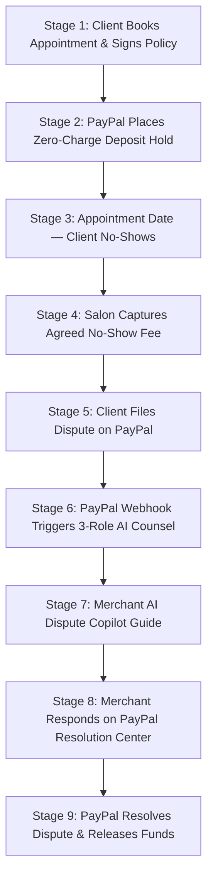

# SalonDesk End-to-End Dispute & Defense Lifecycle Guide

This document provides a comprehensive, step-by-step architectural and operational guide to the SalonDesk dispute flow — from client appointment booking and cryptographic consent to PayPal chargeback ingestion, AI defense generation, and dispute resolution.

> [!NOTE]
> **Non-Custodial Architecture & Official PayPal Resolution Center Workflow**
> SalonDesk operates on a **direct merchant settlement** model: funds flow directly between the client and the salon's PayPal merchant account (`payee.merchant_id`), eliminating platform escrow liability.
> 
> When a client disputes a captured no-show fee, official PayPal dispute processing requires formal service fulfillment proof submitted to the PayPal Resolution Center. SalonDesk's **Autonomous AI Dispute Counsel & Copilot** verifies digital Ed25519 terms consent, validates the SHA-256 financial audit chain, and drafts court-ready legal evidence dossiers to help merchants successfully defend their earned revenue.

---

## 1. Complete Step-by-Step Dispute Lifecycle

---

### Stage 1: Appointment Booking & Cryptographic Consent
1. **Client Action:** The client visits the salon booking catalog (`/client`), selects a service (e.g. *Acrylic Fill-In* or *Box Braids*), and picks an appointment date and time.
2. **Policy Presentation:** Before confirming the reservation, the client is shown the salon's strict cancellation policy:
   > *"A $25.00 deposit authorization hold is required to reserve this appointment time. If you miss your appointment or fail to cancel at least 24 hours in advance, the $25.00 no-show fee will be captured."*
3. **Cryptographic Signing (Ed25519):**
   * The client clicks **"I Agree & Book"**.
   * SalonDesk creates a digital consent payload binding the booking ID, client ID, timestamp, and policy text hash.
   * A cryptographic **Ed25519 digital signature** is generated and recorded.
   * **Database Record:** Stored in the `consent` table with `terms_text_hash` and `signature_b64`.

---

### Stage 2: PayPal Authorization Hold ($25.00)
1. **PayPal Approval:** The client approves the payment via the PayPal checkout window.
2. **Zero Immediate Charge:** No money is immediately transferred to the merchant. PayPal locks an authorization hold for \$25.00.
3. **Ledger Record:** 
   * An immutable entry is appended to `ledger_entry` with event `AUTHORIZATION_ORDER_CREATED` and `AUTHORIZATION_CREATED`.
   * Each ledger entry is sealed with a **SHA-256 hash** chained to the previous entry.

---

### Stage 3: Appointment Day — The No-Show
1. The appointment time arrives. The salon staff prepares the station, reserves chair capacity, and waits for the client.
2. The client does not attend and did not cancel prior to the 24-hour cutoff deadline.
3. In the salon merchant portal (`/merchant`), the stylist or manager updates the appointment status to **"No-Show"**.

---

### Stage 4: No-Show Fee Capture
1. SalonDesk calls PayPal's Capture API to execute a capture of the authorized \$25.00 deposit hold.
2. PayPal completes the transaction and assigns a **PayPal Capture / Transaction ID** (e.g. `76S76437431557423`).
3. **Ledger Events Appended:**
   * `NO_SHOW_FEE_CAPTURED` (\$25.00)
   * `COMMISSION_ACCRUED`
4. Both events are cryptographically hashed into the immutable ledger chain.

---

### Stage 5: The Client Files a Dispute on PayPal
1. The client notices the \$25.00 fee on their card statement and goes to PayPal to dispute the charge, selecting reason:
   * **"MERCHANDISE_OR_SERVICE_NOT_RECEIVED"**
   * Client Note: *"I was charged a $25.00 fee... I never received the service. I am requesting a full refund."*
2. **Official Financial Channels Only:**
   * In the client web application (`/client`), clicking *"Dispute Charge"* displays the client's official **PayPal Transaction ID** and provides a direct link to the **PayPal Resolution Center**, ensuring all disputes follow official financial channels rather than simulated in-app bypasses.

---

### Stage 6: Webhook Ingestion & 3-Role AI Counsel Pipeline
1. PayPal sends real-time webhook notifications to SalonDesk (`POST /api/v1/webhooks/paypal`):
   * `CUSTOMER.DISPUTE.CREATED`
   * `CUSTOMER.DISPUTE.UPDATED`
   * `CUSTOMER.DISPUTE.RESOLVED`
2. **Dispute Counsel Autonomous AI Pipeline:**
   Upon receiving the webhook, SalonDesk automatically launches the 3-role AI legal engine:
   * **Role 1 — Investigator (Deterministic Verification):**
     * Verifies the client's Ed25519 digital signature against the stored policy hash.
     * Verifies the SHA-256 hash chain across all 6 financial ledger records for this booking.
   * **Role 2 — Advocate (Legal Rebuttal Formulation):**
     * Generates a formal 5-section legal rebuttal statement formatted for PayPal's plain-text message box (no markdown tables, no broken asterisks, under 1,500 characters).
     * Automatically inserts the real PayPal Transaction ID, Case ID, and agreed timestamps.
   * **Role 3 — Skeptic (Risk Assessment & Scoring):**
     * Scores the win probability (**94% High Confidence**).
     * Confirms that cryptographic proof, chat acceptance transcript, and policy terms satisfy PayPal Seller Protection guidelines.
   * **Evidence Dossier Generation:** Generates a court-ready, ISO-compliant PDF evidence packet (`evidence.pdf`) with embedded cryptographic checksums.

---

### Stage 7: Merchant AI Dispute Copilot
The salon owner opens `/merchant/disputes` and views the **Dispute Counsel Drawer**. The drawer functions as an interactive **AI Copilot** guiding the merchant through PayPal's exact *"Provide tracking information"* form:

| PayPal Form Field | What to Enter / Select | SalonDesk Copilot Assistant |
| :--- | :--- | :--- |
| **1. Tracking Number** | PayPal Capture / Transaction ID (`76S76437431557423`) | **1-click Copy** button |
| **2. Search Carrier** | Select **"Other"** &rarr; enter `In-Person Salon Service` | **1-click Copy** button |
| **3. Status of Shipment** | Select **"Delivered"** (Service slot held & reserved) | Step-by-step explanation |
| **4. Add a Message** | AI Advocate Legal Rebuttal Statement | **1-click Copy Statement** button (tracks char count vs 2,000 char limit) |
| **5. Supporting Documents** | Cryptographic Evidence Dossier | **1-click Download PDF** button |

The drawer also displays:
* **Customer Dispute Claim Note:** Displays the exact complaint submitted by the buyer on PayPal.
* **Cryptographic Status:** Shows `Verified Safe` across sequential SHA-256 ledger records.
* **Direct Action:** Prominent button to **"Respond on PayPal Resolution Center ↗"**.

---

### Stage 8: Merchant Submits Response on PayPal
1. The merchant clicks **"Respond on PayPal Resolution Center"**.
2. Using the 1-click copy buttons from the AI Copilot:
   * Pastes the **Tracking Number** (`76S76437431557423`).
   * Selects Carrier **"Other"** and pastes `In-Person Salon Service`.
   * Sets status to **"Delivered"**.
   * Pastes the **AI Legal Rebuttal Statement** into the message field.
   * (Optional) Attaches the downloaded **Evidence PDF Dossier**.
3. The merchant submits the form on PayPal.

---

### Stage 9: Dispute Resolution & Fund Release
1. When the client reviews the overwhelming evidence or when PayPal reviews the case:
   * The client cancels / drops the dispute (`outcome_code: "CANCELED_BY_BUYER"`), OR
   * PayPal reviews the salon's rebuttal and rules in seller favor (`outcome_code: "RESOLVED_SELLER_FAVOR"`).
2. **PayPal Funds Release:**
   * PayPal releases the temporary dispute hold (`type: CREDIT`, `reason: HOLD_RELEASED`).
   * The \$25.00 fee is credited back to the salon's available PayPal balance.
3. **Webhook Processing:**
   * PayPal sends **`CUSTOMER.DISPUTE.RESOLVED`**.
   * SalonDesk updates the dispute status to **`RESOLVED_SELLER_FAVOR`**.
4. **Merchant Dashboard Feedback:**
   * A green banner confirms:
     **`Adjudicated: RESOLVED IN SELLER FAVOR (Buyer dropped dispute — Hold Released)`**
     **`+$25.00 Protected`**
   * The action button updates to **"View Resolved Case on PayPal ↗"**.

---

## 2. Core Architectural Pillars

| Architectural Pillar | Implementation & Design Guarantees |
| :--- | :--- |
| **Direct Merchant Settlement** | SalonDesk never holds or custodies client or salon funds. Payments flow directly to the merchant's PayPal account (`payee.merchant_id`), eliminating escrow liability. |
| **Official PayPal Resolution Center** | Disputes follow authentic PayPal financial channels (`CUSTOMER.DISPUTE.*`). Merchants are guided through official PayPal resolution workflows with verified transaction data. |
| **Interactive AI Dispute Copilot** | Equips salon owners with 1-click copy tools for tracking numbers, service fulfillment notes, and plain-text statements optimized for PayPal forms. |
| **Constrained Legal Rebuttal** | Generates a structured 5-section legal rebuttal strictly conforming to PayPal's 2,000-character plain-text message limit without Markdown formatting artifacts. |
| **Cryptographic Proof Chain** | Persistent Ed25519 key signing of client policy agreement and unbroken SHA-256 hash chaining across financial ledger events guarantee tamper-evident records. |

---

## 3. Database Schema Reference

| Table | Role in Dispute Flow |
| :--- | :--- |
| `booking` | Stores appointment time, status (`NO_SHOW`), agreed no-show fee, and cancellation deadline. |
| `consent` | Stores Ed25519 digital signature, signed payload, and terms hash. |
| `payment_hold` | Stores PayPal authorization order ID and hold status. |
| `payment_capture` | Stores PayPal capture ID (`76S76437431557423`) and captured amount. |
| `dispute_case` | Stores 3-role AI analysis, legal rebuttal text, win score, buyer messages, and resolution outcome. |
| `ledger_entry` | Append-only, SHA-256 hash-chained financial record proving immutability. |
| `paypal_webhook_event` | Audit table logging incoming PayPal webhooks (`CREATED`, `UPDATED`, `RESOLVED`). |
